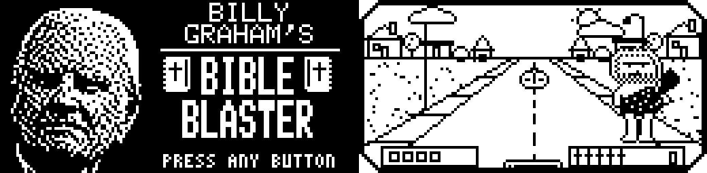
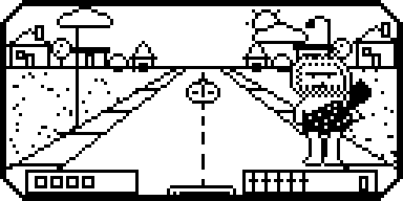
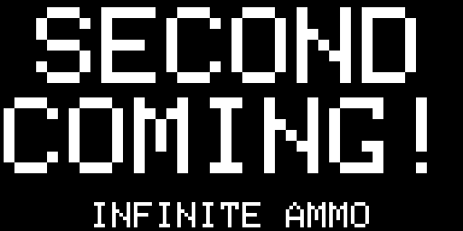
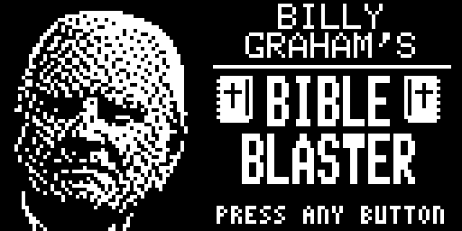
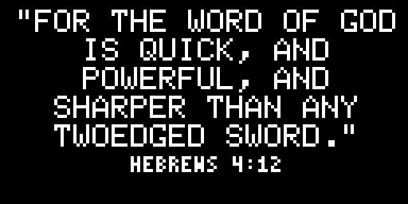
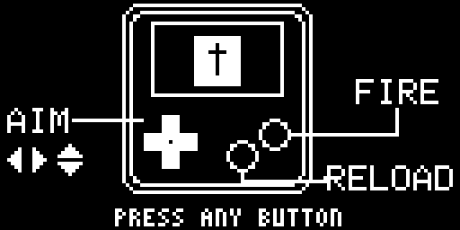
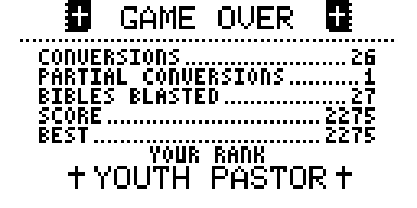

# Billy Graham's Bible Blaster

Heathens are crossing the street. Stand at the end of the road with a stack of
bibles and convert them before they get away.

By **jaychugstein** · MIT License · Arduboy (also runs on Arduboy FX, FX-C and Mini).

**Play it in your browser:** https://jaychugstein.github.io/Billy-Grahams-Bible-Blaster/ (works on phones too)

 

## Controls

| Button | What it does |
|---|---|
| Left / Right | Aim |
| Up / Down | Lob farther or nearer (far, middle and near rows) |
| Outer button | Throw the bible in your hand |
| Inner button | Reload (six bibles) |

## How it plays

* Hit a caveman square on and he's converted into a man in a suit:
  **GOT HIM** or **ALL RIGHT! FULL CONVERSION**.
* Just clip him and **YOU JUST WINGED HIM AND MADE HIM A UNITARIAN**.
  Hit him again to finish the job.
* One bible, two heathens: **DOUBLE CONVERSION**.
* **LOOK OUT! A GENTLE BAHAI** floats by now and then. He's worth extra.
* Convert ten and it's the **SECOND COMING!**: fifteen seconds of infinite ammo.
* Every heathen who makes it across the street costs you a cross. Lose all five
  and it's game over.

The end screen shows conversions, partial conversions, bibles blasted, your
score, your best, and your rank, from **Pew Warmer** to **Billy Graham**.

 
 

## Install

Load `release/BibleBlaster.arduboy` with any Arduboy uploader (for example the
Arduboy Web Flasher or the Arduboy-Python-Utilities), or upload
`release/BibleBlaster.hex` directly.

## Building from source

**Arduino IDE:** install the Arduboy2 library, open `BibleBlaster/BibleBlaster.ino`
and upload with the board set to *Arduino Leonardo* (or the Arduboy board package).
All the game code is in `BibleBlaster/game.cpp`; the `.ino` file is only there so
the IDE can open the project.

**Command line:** `./build.sh` (set `AVR_GCC`, `ARDUINO_AVR` and `ARDUBOY2` if your
copies live somewhere other than the defaults at the top of the script).

**Art:** the pictures are generated by the Python scripts in `art/` (they need
Pillow). Run them from inside the `art` folder:
`make_sprites.py`, `make_bg.py`, `make_title.py`, `make_ctrl.py`.

## Credits

* Game, art and code: jaychugstein
* 5x7 font from the Arduboy2 library (BSD 3-Clause)
* Browser version runs on the Ardens emulator by Peter Brown (MIT, see `docs/ARDENS_LICENSE.txt`)
* Inspired by *The Simpsons* season 11 Episode 14. Bible verse: Hebrews 4:12, King James Version.
